# Book Converter app — UI/UX audit (Phase 1)

Date: 2026-11-15. Scope: the whole app UI. Conversion and export output are out of scope and must not change.

**How it was made.** Every screen was captured with Playwright (Chrome, 1440×900, scale 2) on a **test copy** of the app
(port 8779, own data folder), using copies of job `b919e59e0c41d19b` (258 pages, DAISY 3) and `3211b89dd49cb4fd` (51 pages, Jaypee v5).
Two 4-page test PDFs were uploaded there to show a running and a cancelled conversion. Nothing was saved on the live app (8777);
it was only read. Script: `experiments/ux_audit_shots.py`. Screenshots: `docs/app_ux_audit/before/`.

Severity: **P1** wrong / misleading / broken · **P2** slows people down or confuses · **P3** polish.

---

## 0. Problems across the whole app

| # | Problem | Sev |
|---|---|---|
| G1 | No loading state on several screens: *Check an edited delivery* showed a **blank page** for seconds while the server was busy (profile list took >1 s, longer during a conversion). | P1 |
| G2 | Internal names shown to users: `jaypee_v5@5.0.0`, `daisy3_base`, "Stage 5 of 18", "unit boundary below confidence", `accept`, "PARAGRAPH · BODY", "HEADING · LEVEL 3 · SECTION", "LIST · NUMBERED", WARN/FAIL in capitals. | P1 |
| G3 | ALL-CAPS labels (kind headers, "HOW IT WILL LOOK IN THE BOOK", verdict badges) — against the sentence-case rule. | P3 |
| G4 | No colour/icon system for element types: Part/Chapter/Section and Picture/Table/List/Box/Heading/Paragraph look different on Review, Browse and the chapters panel. | P2 |
| G5 | No "what to do next" line on most screens; the step bar shows where you are but not what is missing (e.g. "book parts not confirmed", "12 items left"). | P2 |
| G6 | No help: no "?" per screen, no first-time tour. | P2 |
| G7 | The top bar is the same for managers and reviewers (reviewers see *New book*, *Queue*). | P3 |
| G8 | "Free disk: N GB" is always shown in the top bar but never warns when low (one big book uses ~2 GB). Correction: the 8 GB in the screenshots is the test copy's folder in `/tmp`; the live app has 78 GB free. | P3 |
| G9 | Changes that alter the book are inconsistent: Browse buttons save immediately ("Set level", "Not a heading", "Save title"…), the Change dialog previews first. | P1 |

---

## 1. Sign in / role

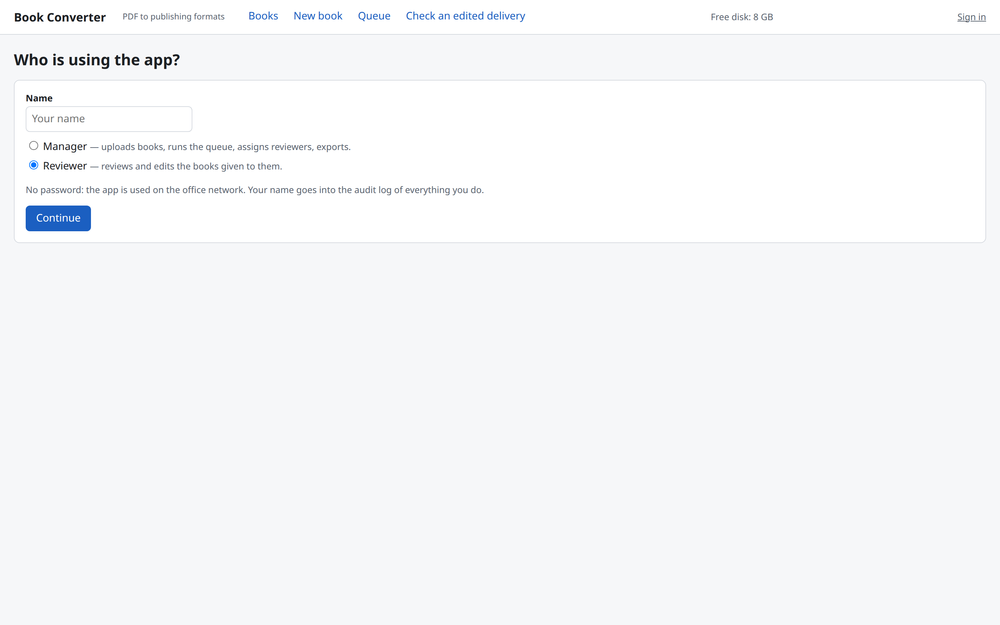

- Clear and short. Default role is *Reviewer* — good.
- P3: a one-line explanation of what changes with the role would help ("Managers also see Upload and Queue").
- P3: "Sign in" in the top bar looks like a link but is the current-user name; there is no visible "switch user".

**Proposal:** keep; add "Switch user" in the user menu; show recent names as quick picks.

## 2. Books list (manager, reviewer, assign reviewers)

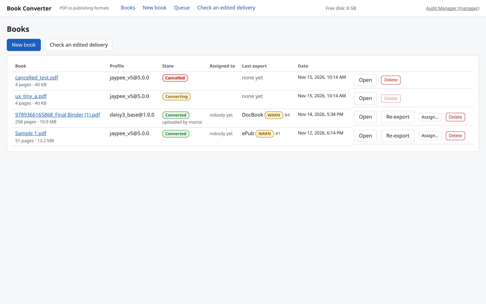
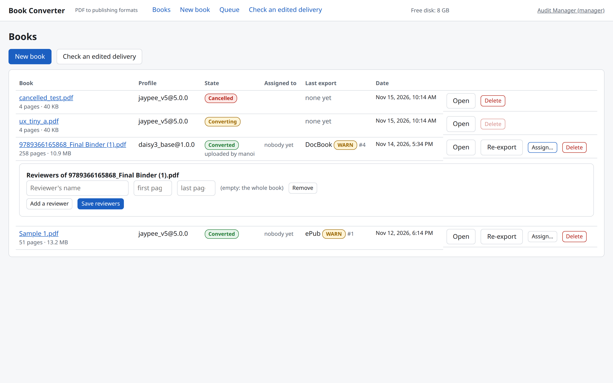
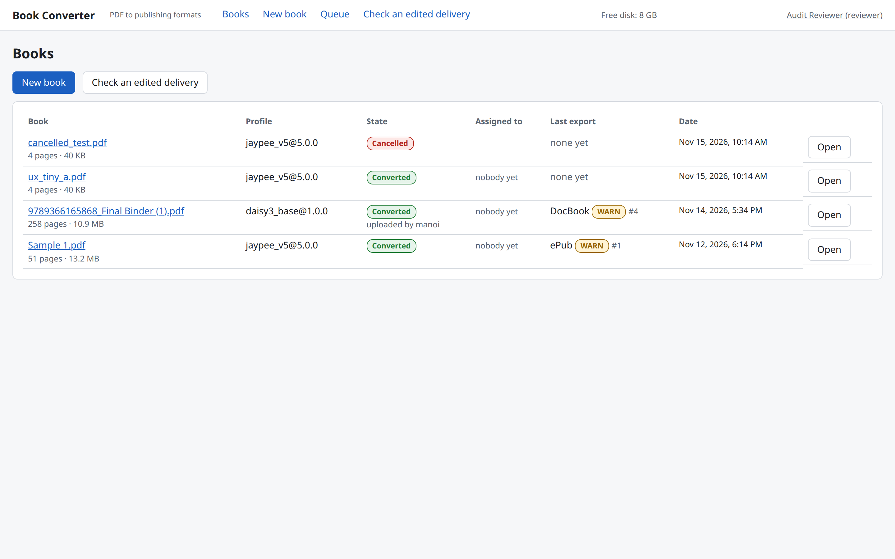

- P2: no search, filter or sort; fine with 4 books, not with 40.
- P2: no review progress per book (the API already returns `review_progress`: e.g. "646 of 646 decided" / "0 of 867"). State only says *Converted*.
- P2: no "next step" per book (e.g. "Review: 120 left", "Ready to export", "Exported — warnings").
- **P1 bug:** Last export shows "DocBook WARN #4" but that export was **DAISY 3**. `view_books.js:56` labels every format that isn't ePub as "DocBook", so DAISY, NIMAS, HTML, JATS and BITS exports are all shown as "DocBook".
- P2: *Delete* sits next to *Open* in red with no distance; disabled *Delete* on a converting book has no reason given.
- P2: Assign panel: placeholders cut ("first pag", "last pag"); "(empty: the whole book)" is unclear; no list of known reviewer names; "Save reviewers" can be pressed with an empty name.
- P2: Reviewer view: there is no "My books" section unless something is assigned, and no empty-state message saying "Nothing is assigned to you yet".
- P3: "Re-export" next to "Open" is a heavy action for a list row.

**Proposal:** a search box + filters (state, profile, reviewer) + sort; a progress bar per book with the next step in words; a "Continue where I left off" card at the top (last book + page/item you were on); *Delete* moved into a "⋯" menu with confirm; Assign as a small dialog with name suggestions and "pages 1–258 (whole book)" pre-filled.

## 3. New book (single + multiple upload)

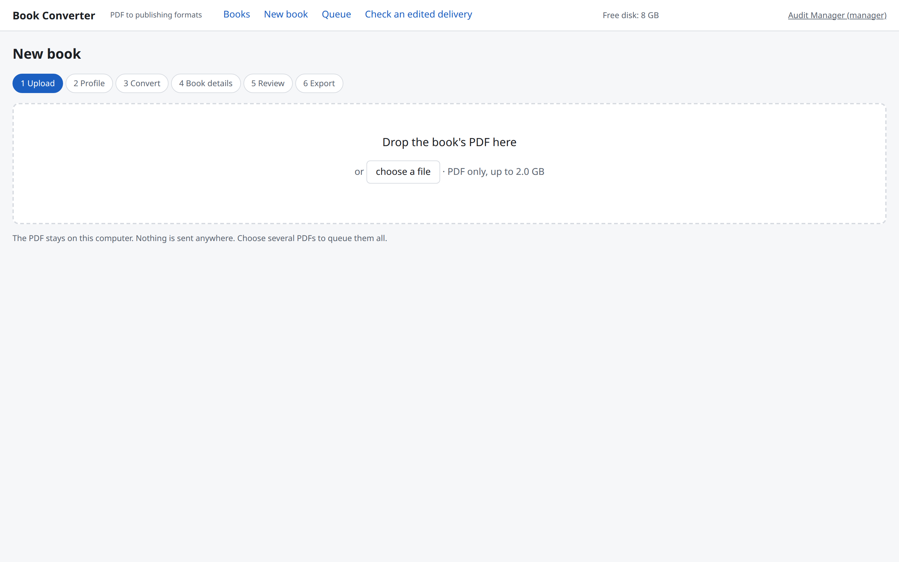
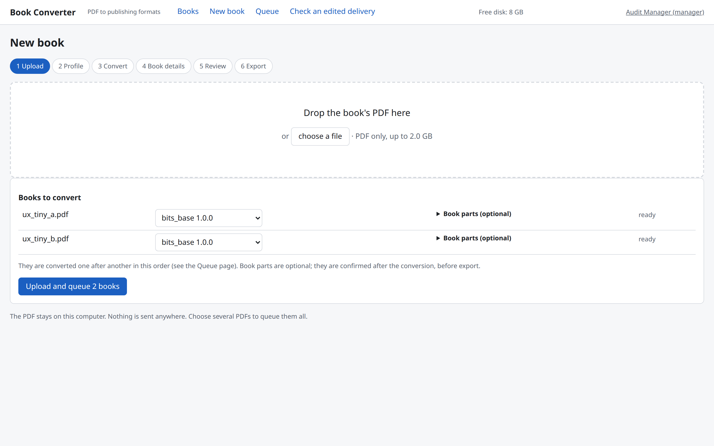

- P2: with several files the profile defaults to **bits_base** (first in the alphabet) for every file — easy to queue the wrong profile. No "same profile for all".
- P2: "ready" in the right column is ambiguous (ready to upload? converted?).
- P2: no remove-file button; no duplicate-ISBN / same-file warning; no page count or size before upload.
- P3: the single-file path and the multi-file path look different.

**Proposal:** one list for 1..N files with page count, size, profile per file (with "Apply to all"), optional parts, a remove "×", a warning if the ISBN/file already exists, and one primary button "Upload and convert N books".

## 4. Profile (pick / YAML upload / AI prompt)

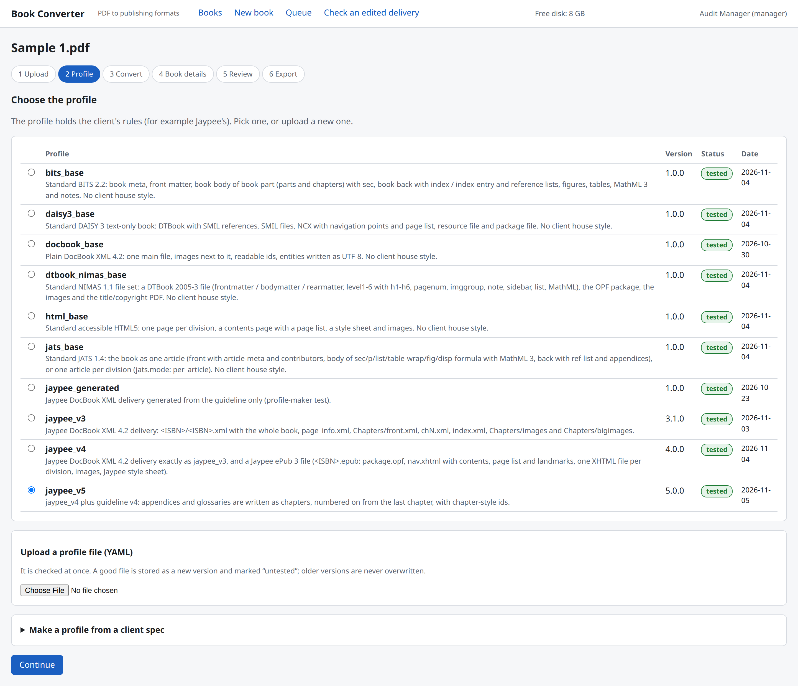
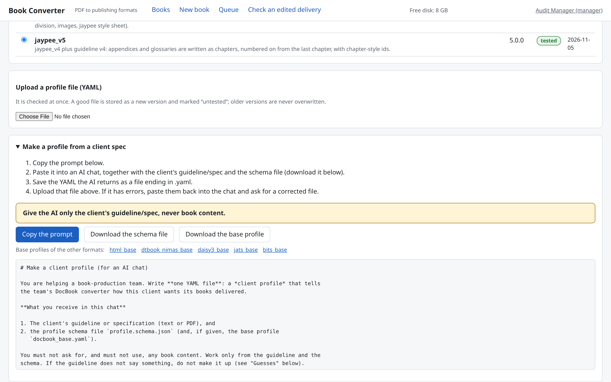

- P1 (jargon): descriptions are written for engineers ("book-meta, front-matter, book-body of book-part … sec, MathML 3", "DTBook with SMIL references, NCX"). An office worker cannot pick from this.
- P2: ten profiles in one flat list; the client ones (Jaypee) are at the bottom; no grouping, no "recommended for this client".
- P2: date wraps ("2026-11-\n04").
- P2: *Continue* is far below the list (needs scrolling).
- P3: the AI-prompt panel is useful but heavy; it shows file names like `dtbook_nimas_base`.

**Proposal:** two groups — *Client profiles* (Jaypee v5 …) and *Standard formats* (ePub, DAISY, NIMAS, HTML, JATS, BITS, DocBook) — each with a plain one-line description ("ePub 3 + Jaypee DocBook XML, Jaypee house style") and technical detail under "Details". Sticky *Continue*. Upload and AI panels collapsed under "Add a new profile".

## 5. Queue

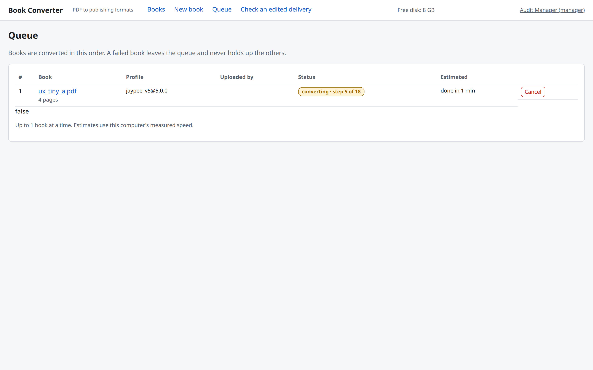

- **P1 bug: a stray "false" is printed under the table.**
- P2: "converting · step 5 of 18" — internal stage count; ETA is there ("done in 1 min") but not on the Books list.
- P2: "Uploaded by" empty for API uploads.
- P2: no retry for a failed/cancelled book; no notification when a book finishes.

**Proposal:** fix the "false"; status in words ("Finding columns and tables — about 1 min left"); *Retry* on failed/cancelled; an in-app toast + Books-list badge when a conversion finishes.

## 6. Convert progress / done / cancelled

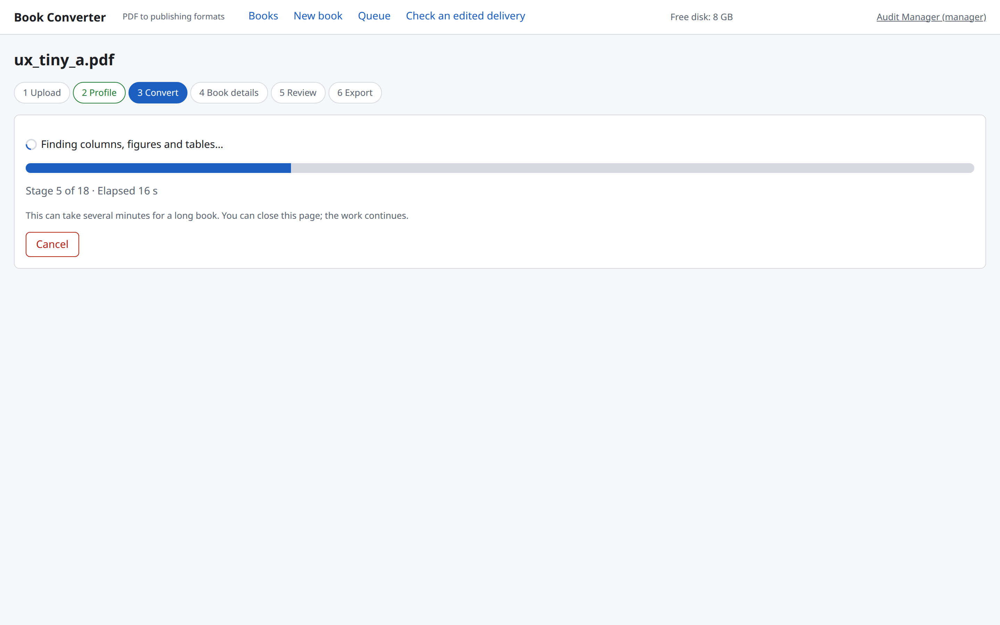
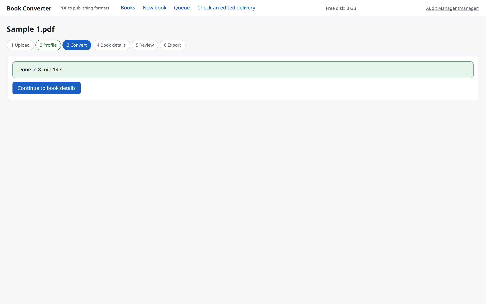
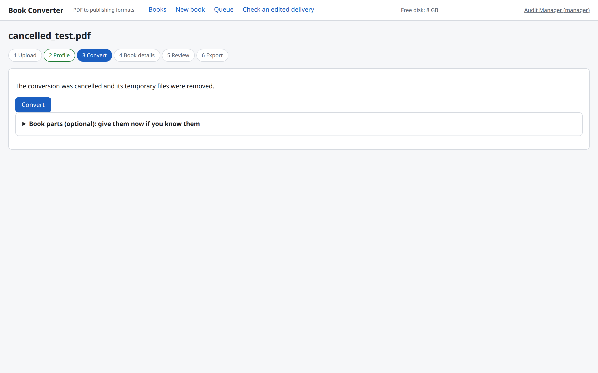

- P2: "Stage 5 of 18 · Elapsed 16 s" — no ETA here although the queue has one.
- P2: *Cancel* is the only button and is red outlined next to the progress — easy mis-click, no confirm.
- P2: Cancelled state: the primary button is just "Convert"; it should say "Convert again".
- P3: "Done in 8 min 14 s." — fine; add what comes next ("Next: check the book details").

**Proposal:** ETA + plain stage + "You can close this page; we will tell you when it is done"; Cancel behind a confirm; *Convert again* / *Retry* on cancelled/failed with the failure reason in plain words.

## 7. Book details and Book parts

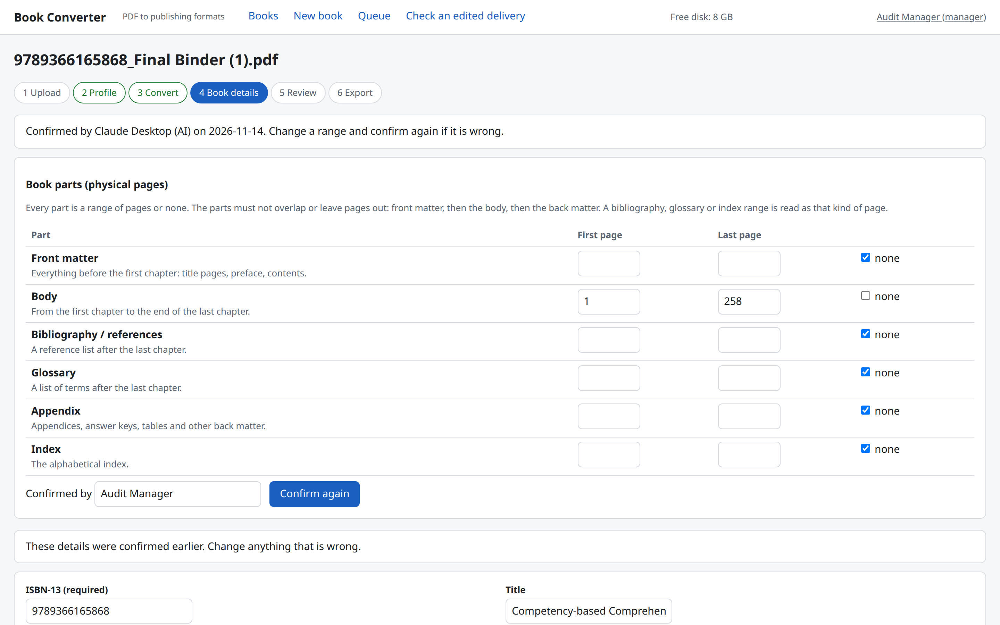

(full page: `13b_book_details_full.png`)

- P2: the page is called *Book details* but opens with **Book parts** (page ranges); the metadata form is below the fold.
- P2: "Confirmed by Claude Desktop (AI) on 2026-11-14" — parts were confirmed by an AI tool; a person cannot tell whether they still need to check them.
- P2: only ISBN says "(required)"; other required fields are not marked; no example placeholders. Title input is cut ("Competency-based Comprehen").
- P2: six empty range rows with "none" ticked — a lot of empty boxes; "physical pages" vs printed page numbers is not explained.
- P3: two separate save buttons (*Confirm again* for parts, *Save* for details) on one page.

**Proposal:** split into two clear sections with a status line each ("Details: 2 required fields missing" / "Parts: confirmed by …"); required fields marked and first; examples in placeholders (ISBN "978…", date "2026-03"); full-width title; parts as a compact range bar over the page thumbnails, rows only for parts that exist ("+ add bibliography").

## 8. Review — flagged items

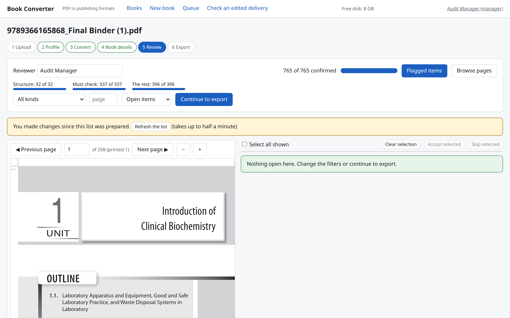
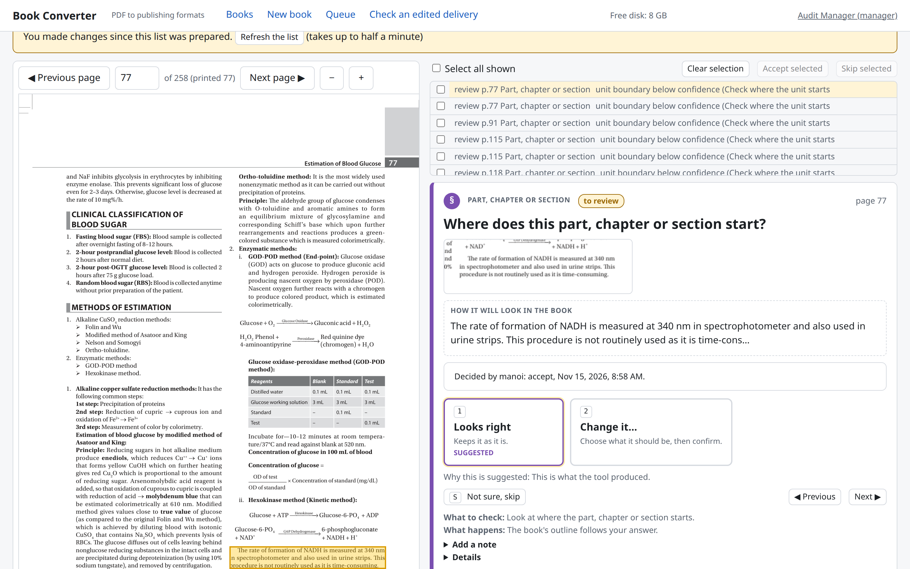
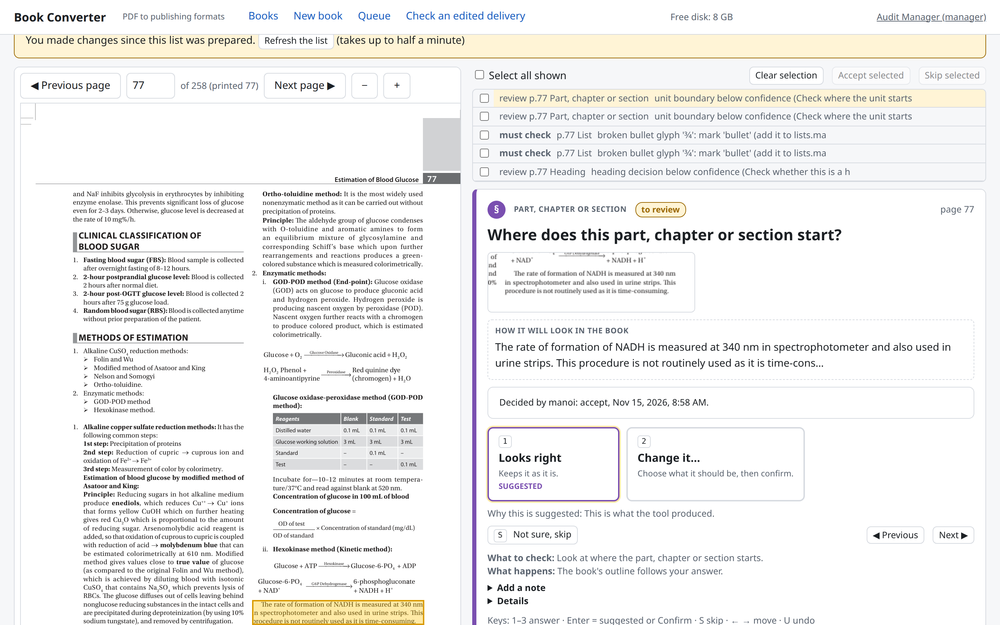

Known problems — all reproduced on the copy of b919e59e0c41d19b, page 77:

1. **P1 — question does not match the item.** p.77 has two structure items for **different** units: one marks where a unit *starts* (heading at the top of the right column) and one where the previous unit *ends* (the NADH paragraph at the bottom). Both cards ask "Where does this part, chapter or section start?"; the second one shows a body paragraph crop and only offers *Looks right / Change it…*. The answers don't say what "looks right" means.
2. **P1 — crop too small / PDF not on the problem.** The crop is ~400×110 px and cut at the sides ("of / nd / 0%"); the preview text is cut ("time-cons…"). The yellow highlight is at the **bottom** of the PDF page, below the fold — the PDF does not scroll or zoom to it.
3. **P1 — raw reasons and duplicates in the list.** Rows show "unit boundary below confidence (Check where the unit starts…", "broken bullet glyph '¾': mark 'bullet' (add it to lists.ma" — cut mid-word. p.77 ×2 and p.115 ×2 (structure), and the two p.77 list rows are the same text. Across the book 100 (kind, unit) pairs appear more than once.
4. **P1 — status contradicts itself.** Header: "765 of 765 confirmed"; card badge: "to review"; card text: "Decided by manoi: accept". The yellow banner "You made changes since this list was prepared. Refresh the list" never goes away (the list is `stale` since the last edit), even when nothing is being refreshed. "Open items" shows "Nothing open here" while the PDF on the left still shows page 1 of the book.

Further problems:

- P2: "Decided by manoi: **accept**" — internal action word.
- P2: Filters: kinds are a dropdown of internal kinds (`page_label`, `join`, `language`…); page filter has no label; no "My items" / reviewer filter.
- P2: bulk bar (Select all / Accept selected / Skip selected) is always visible above the list, adding noise and risk.
- P2: group progress "Structure / Must check / The rest" — "The rest" is unclear.
- P2: "Similar items" group answer is hidden at the bottom of the card inside a collapsed "details".
- P3: Keys line is at the very bottom; ← → move but are also used by the page number field.
- P3: the item list is a fixed-height scroll box showing 5 rows.

### Card kinds

All captured with "All items": `18_card_<kind>.png` for alt_text, caption, character, figure, heading, join, language, list, page_label, structure, table.

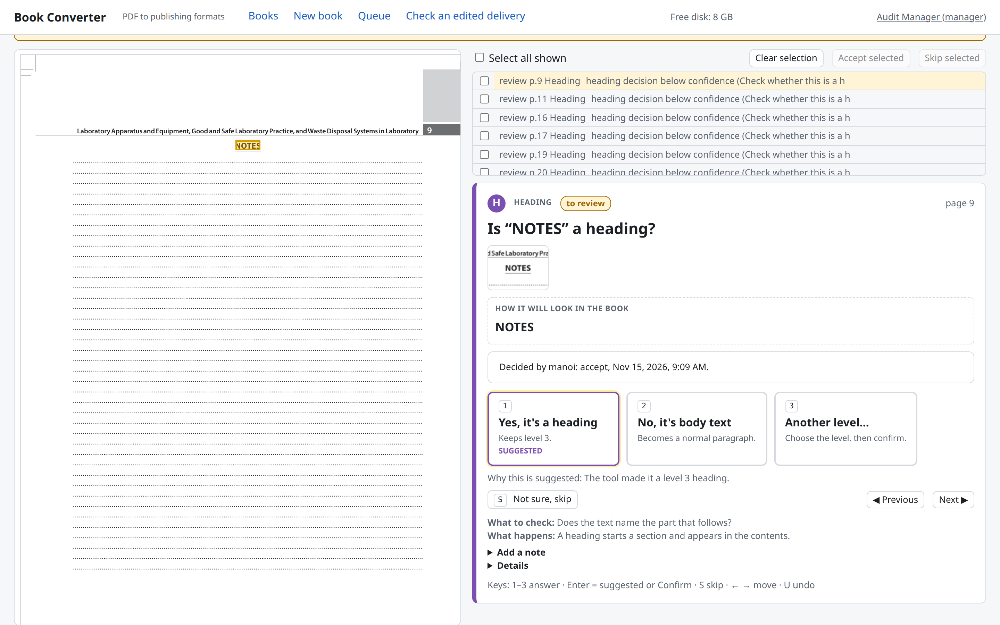

- The *heading* card is the best model: a clear question ("Is "NOTES" a heading?"), answers that answer it, a readable crop. Even so: crop is tiny compared to the space, "Keeps level 3" is jargon.
- *structure* (start/end of part/chapter/section) — see 1–2 above; needs separate questions for "starts here" and "ends here", and to show the heading that starts the unit.
- *list* "broken bullet glyph '¾'" — question should be "Is "¾" a bullet in this list?" with "Yes, it's a bullet / No, keep the character".
- *page_label*, *language*, *character*, *join* — questions are understandable but answers end in "Looks right"; they should name the result ("Yes, page 'xii'").

**Proposal (card):** kind icon + plain question built for the item **and** its sub-type (start vs end); answers that name the result ("Yes, the chapter starts here" / "No, it doesn't" / "Change it…"); crop at least half the card width with context and the problem area outlined; PDF auto-scrolls and zooms to the highlight; "How it will look in the book" with full text (wrapped, not cut); one-line *What to check* at the top; status badge always from the decision (Open / Decided by X, Mon 09:12 / Needs your confirm). Details (raw reason, source) only under "Details".

**Proposal (list):** each row = icon + page + the same plain question (truncated at a word) + status dot; one row per unit (merged reasons under Details); filters as chips: kind (plain names), page range, reviewer / *My items*; status counts in the chips. Stale list refreshes in the background with a small "Updating the list…" line; the banner disappears when done.

## 9. Your changes (audit log)

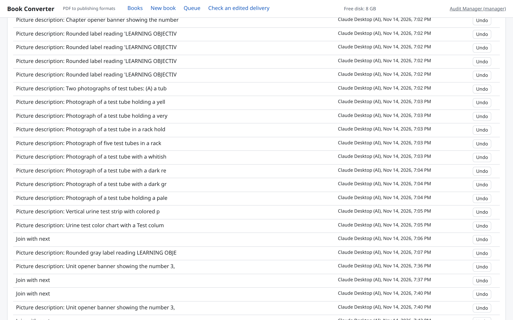

- P2: entries are written in internal terms ("[same as another change] Heading level 3 (was: …)", "Belongs to the chapter before").
- P2: no filter (mine / everyone / this page), no "go to" link to the page or block.
- P2: *Undo* has no confirm and doesn't say what will come back.

**Proposal:** a "History" side panel: "Audit Manager made "CLINICAL CLASSIFICATION…" a section heading · p.77 · 10:14 — Undo · Show"; filters Mine / All; Undo with a one-line preview.

## 10. Browse pages (blocks, Change element, Chapters and parts)

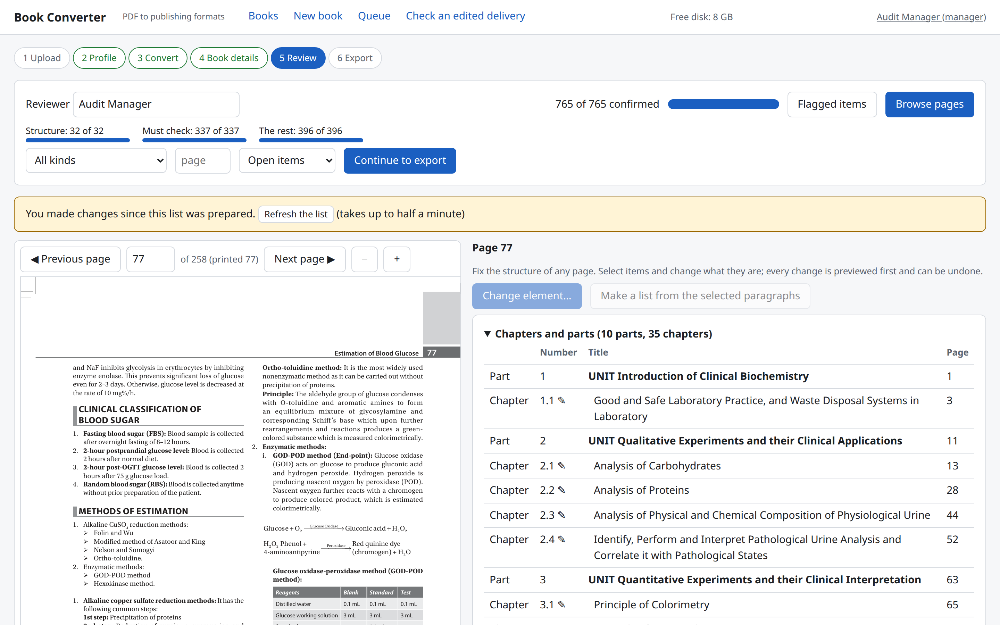
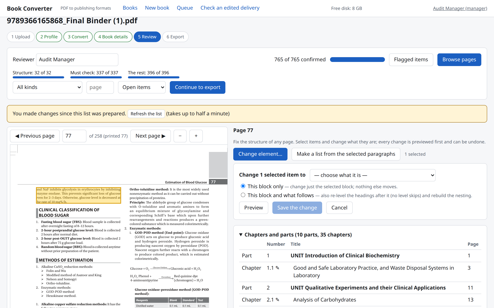
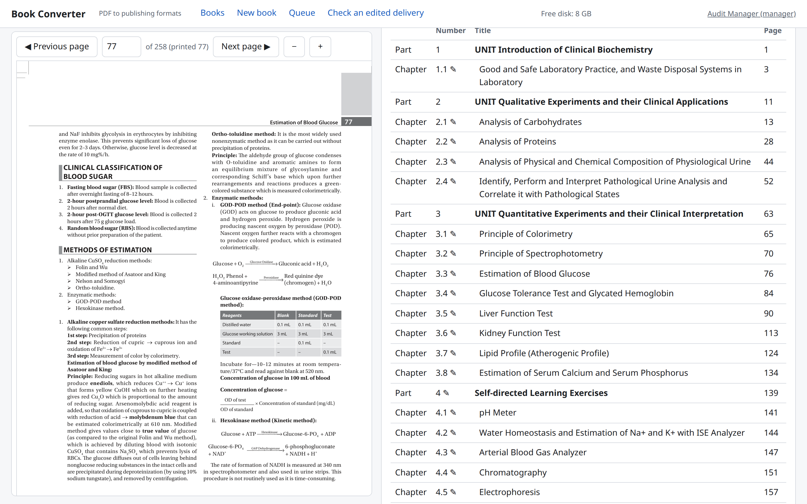
(full page: `20b_browse_p77_full.png`, another page: `23_browse_list_page.png`)

Known problems — all reproduced on p.77:

5. **P1 — too many controls per block.** A heading row shows: ↑ ↓ "Read this column first" "Change…" + level select + Set level + Not a heading + Start a new chapter here + kind select + Set kind + Number + Set number + Belongs to the chapter before + title input + Save title + a sentence of help. A paragraph row: Make heading (select + button), Number + Start a new chapter here, Split here… Most save **at once** without preview (see G9).
6. **P1 — technical labels:** "PARAGRAPH · BODY", "HEADING · LEVEL 3 · SECTION", "LIST · NUMBERED".
7. **P1 — raw text:** "CLINICAL CLASSIFICATION OF ⏎⏎ BLOOD SUGAR" (blank line inside a heading); list items joined with " | " and cut mid-word ("Fasting blood sugar (FBS): Blood sample is collected after  | 2-hour postprandial glucos"); paragraph text keeps the PDF line breaks.
8. **P1/P2 — layout:** PDF and blocks are linked only one way (hover a block → highlight); clicking the PDF does nothing. The PDF pane has a sideways scrollbar (the page is wider than the pane at zoom 1). The toolbar isn't sticky — the page-number box and Change element scroll away. The "Number" input is cut ("Numbe"). *Change element…* and *Make a list…* look disabled (they are, until something is ticked — with no hint). No search.

Further problems:

- P2: the **Chapters and parts** table (45 rows) sits **above** the blocks, pushing the page's blocks far down; on every page.
- P2: "Read this column first" on every block is confusing (it's a page-level action).
- P2: the Change dialog opens above the chapters table, away from the block it changes; "This block and what follows — also re-level the headings after it (no level skips) and rebuild the nesting" is jargon.
- P2: Chapters table: "UNIT Introduction of…" — the printed label "UNIT" is glued to the title; "✎" meaning isn't explained.
- P3: page thumbnails / outline navigation missing; ← → keys don't change pages.

**Proposal:** each block = one line: coloured type badge (Heading · Section, Paragraph, List (numbered), Picture…) + clean text (wrapped lines joined, list shown as real list items, cut only at a word with "…"). Click or *Edit* opens a small panel next to the block with only the actions for its type, in groups — *What is it?* · *Number* · *Title* · *Move / merge / split* — and every change goes preview → Save → Undo. PDF ↔ blocks linked both ways (hover/click either side); page fits width (no sideways scroll); sticky toolbar (page, zoom, search, Edit); page thumbnails strip; search text in the book; ←/→ pages; chapters panel moved to a collapsible left "Outline" that marks the current chapter.

## 11. Export and QC report

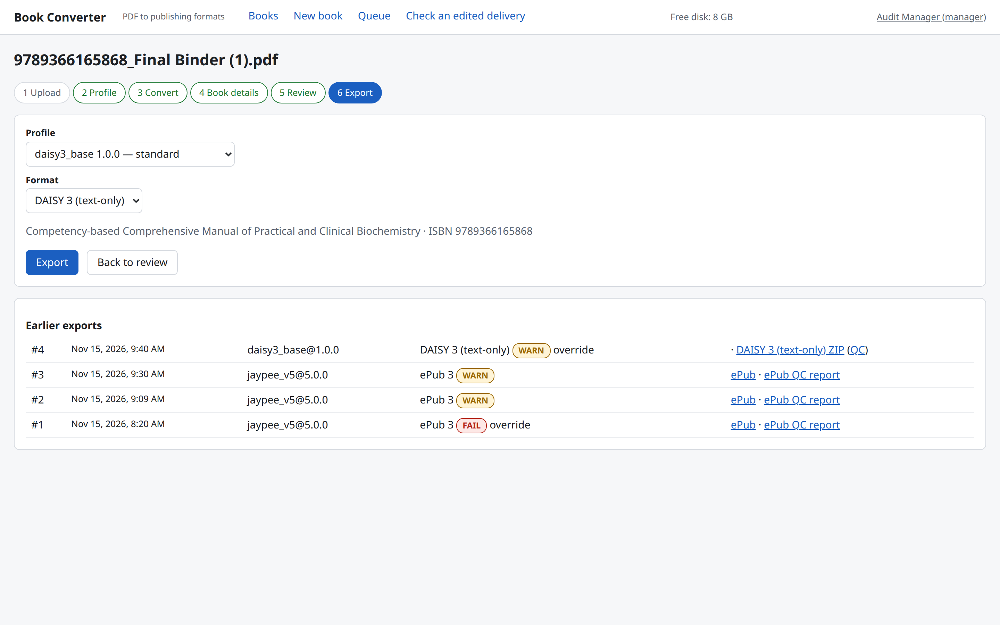
(full: `24b_export_full.png`, history: `25_export_history.png`)

- P2: one format per run; the profile's formats are in a dropdown — no "Export all formats".
- P2: "Earlier exports": "WARN override", "FAIL override" — what was overridden and why isn't shown; links "(QC)" / "ePub QC report" differ per row.
- P2: no summary before export of what is still open (e.g. 0 open items, parts confirmed, details complete).
- P2: the QC report (captured in the tutorial, see `docs/tutorial/shots/10_export_qc.png`) lists checks by internal names (lossless, DTD, EPUBCheck) without linking to the items that cause a WARN/FAIL.
- P3: "Back to review" is the only next step; no "Download" emphasis after a good export.

**Proposal:** a readiness checklist at the top (details ✓, parts ✓, review 765/765 ✓); one primary "Export all formats" (with per-format checkboxes under "Choose formats"); result as plain PASS / WARN / FAIL per check with a one-line reason and "Show the N items" linking to Review/Browse; a download history table with who/when/what was overridden.

## 12. Check an edited delivery

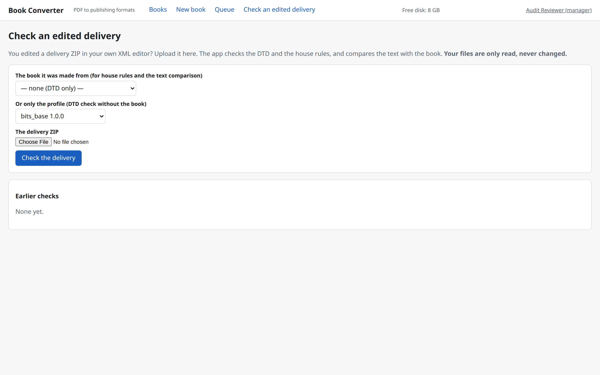

- **P1:** blank page while loading (no spinner) — see G1.
- P2: "— none (DTD only) —" is jargon; the purpose ("someone edited the files outside the app — check them before delivery") isn't stated.

**Proposal:** title + one-line purpose, a loading state, a drop zone for the ZIP, book picker labelled "Compare with this book (optional)".

## 13. Errors, empty states, loading

- `28_error_missing_book.png` "No such book." and `29_unknown_page.png` "That page does not exist." — plain, but no way back ("Go to Books").
- Review "Preparing the review list… (a long book can take half a minute)" — fine; it blocks the whole page even when a list exists.
- Empty review list message is good; an empty Books list for a reviewer has no message.
- Errors from the server are shown as raw `detail` text in places (e.g. upload "This PDF cannot be opened; it may be damaged." — good; others show codes).

**Proposal:** one error component: what happened + what to do + button (Back to books / Try again); one empty-state component; skeleton rows instead of blank pages.

---

## Prioritised feature list

Effort: S ≤ ½ day · M 1–2 days · L 3–5 days. All are UI only (static JS/CSS + read-only API helpers); no change to conversion or export output.

| # | Item | Screens | Sev | Effort |
|---|---|---|---|---|
| 1 | Review card: question per item **and** sub-type (start/end of unit; list bullet; etc.), answers that name the result, status badge from the decision, "Decided by X" in words | Review | P1 | M |
| 2 | Review: bigger crop with context; PDF auto-scrolls + zooms to the highlight; "How it will look" without cutting | Review | P1 | M |
| 3 | Review list: plain question per row, merge duplicates per unit (reasons under Details), cut at word | Review | P1 | M |
| 4 | Stale list refreshes in the background; banner only while refreshing; counts always consistent | Review | P1 | M |
| 5 | Browse: one line per block (type badge + clean text: joined lines, real lists, no mid-word cut) | Browse | P1 | M |
| 6 | Browse: one *Edit* panel per block with grouped, type-specific actions; every change preview → save → undo | Browse | P1 | L |
| 7 | Browse: PDF ↔ block linked both ways; fit width (no sideways scroll); sticky toolbar; ←/→ pages | Browse | P1 | M |
| 8 | Fix bugs: stray "false" on Queue; blank Check page (loading state); cut placeholders ("Numbe", "first pag"); title input cut; Books "last export" format label | Queue, Check, Browse, Books, Details | P1 | S |
| 9 | Plain-language pass + shared badge/icon/colour system (Part/Chapter/Section; Picture/Table/List/Box/Heading/Paragraph); sentence case; tech terms only under Details | All | P1 | M |
| 10 | Step bar with "what to do next" + readiness counts on every book screen | All book screens | P2 | S |
| 11 | Books list: search, filters, sort, progress bar + next step per book, "Continue where I left off" | Books | P2 | M |
| 12 | Copy a job (for testing/training) | Books | P2 | S |
| 13 | Export: readiness checklist, "Export all formats", plain PASS/WARN/FAIL with links to items, download history | Export | P2 | M |
| 14 | Review: filter chips (plain kinds, page range, reviewer, *My items*), group answers ("N look like this — apply to all?") visible on the card, "Open in Browse" | Review | P2 | M |
| 15 | Browse: search in the book, page thumbnails, Outline panel instead of the big chapters table above the blocks | Browse | P2 | M |
| 16 | History panel: readable entries, Mine/All, go-to link, undo with preview | Review/Browse | P2 | S |
| 17 | Upload: one list for N files, profile per file + "Apply to all", remove, duplicate-ISBN/file warning | New book | P2 | M |
| 18 | Profile page: client vs standard groups, plain descriptions, sticky Continue | Profile | P2 | S |
| 19 | Queue/Convert: ETA everywhere, plain stage, retry, confirm on cancel, finished notification | Queue, Convert | P2 | M |
| 20 | Book details: details first, required marked, examples, compact parts | Details | P2 | S |
| 21 | Help "?" per screen (3 lines) + short first-time tour; role-aware top bar | All | P2 | S |
| 22 | Keyboard shortcuts shown on screen for Review and Browse | Review, Browse | P3 | S |

Suggested order: 8 → 1–4 → 5–7 → 9–10 → 12 (needed for safe testing) → 13–16 → 11, 17–21 → 22.
Total ≈ 4–5 weeks of work for one person; items 1–9 (≈ 2 weeks) remove all P1 problems.

**Questions (answered 2026-11-15)**

1. Browse edits that today save at once: move them all to preview → confirm? — **Decided: yes (an inline one-line preview is fine).**
2. Merge duplicate review rows, keeping the old decision keys? — **Decided: yes, but "unit starts here" and "unit ends here" stay separate items with their own questions.**
3. "Copy a job" copies ~0.1–2 GB per book. Copy without the page cache (re-built on demand)? — **Decided: yes.**

---

## Release A — quick fixes (done)

Tested on the 8779 test copy. Screenshots after the release: `docs/app_ux_audit/after_A/`.

| Fix | Before | After |
|---|---|---|
| Stray "false" on Queue (also a hidden "false" in the Convert page's parts plan and "undefined" for a picture with no file name in Browse): one safe `append()` helper | `before/09_queue.png` | `after_A/09_queue.png` |
| Books list: every non-ePub export was called "DocBook"; now DocBook / ePub / HTML / NIMAS / DAISY 3 / JATS / BITS from one shared name list | `before/02_books_manager.png` | `after_A/02_books_manager.png` |
| Loading message on every screen until it draws (Check an edited delivery was blank); plainer Check page labels | `before/27_check_delivery.png` | `after_A/27_check_delivery.png` |
| Cut inputs: Assign "from page / to page", Browse "Number", Book details fields full width, part page boxes | `before/03_assign_reviewers.png`, `before/13_book_details.png` | `after_A/03_assign_reviewers.png`, `after_A/13_book_details.png` |
| Book details first (required fields marked, examples in placeholders), Book parts below | `before/13_book_details.png` | `after_A/13_book_details.png`, `after_A/14_book_parts.png` |
| Parts confirmed under the assistant's name ("Claude Desktop…") are shown as *filled in*, not confirmed; the export asks for a person's confirmation (server rule, same as the review cards' rule) | `before/14_book_parts.png` | `after_A/14_book_parts.png` |
| Upload: profile = last used on this computer, else the newest jaypee_v5; "Profile for all books" | `before/06_new_book_multiple.png` | `after_A/06_new_book_multiple.png` |
| Stale list: refreshed by itself in the background a few seconds after a change; the banner shows only while it updates; the card being answered is not redrawn. Card badge and list rows follow the decision (done / needs your confirm / must check / to review) | `before/17_review_page77.png` | `after_A/17_review_page77.png` |
| PDF scrolls to the highlight: the pane fits the window and centres the problem area; sticky page toolbar | `before/17_review_page77.png` | `after_A/17_review_page77.png` |

Check: DAISY 3 export of the copy of b919e59e0c41d19b with the same decisions is identical to the earlier export #4 except who confirmed the parts and the run time; lossless 0 missing / 0 extra, DTD 0 errors.

**Note for the live app:** after this release, books whose parts were filled in only by the assistant need a person to press *Confirm book parts* before the next export: today b919e59e0c41d19b (Final Binder) and 965d78af65efc4c4 (9789372029260). The ranges stay the same, so nothing is converted again.

---

## Correction: what a "unit" is

The audit (section 8, problem 1) read the two p.77 *Part, chapter or section* items as "where a unit starts" and "where the previous one ends". That was wrong. In the converter a **unit is one block of text** (a paragraph or a list entry), and `unit boundary below confidence` means the converter is not sure where *that paragraph* starts and ends. The two p.77 items are two different paragraphs (the NADH paragraph, and a piece of the H₂O₂ equation read as a paragraph). There is no start/end pair. The card now asks about the paragraph, and these items are never merged with other flags.

## Release B1 — the review card (items 1–2), commit 92c90ec4

- The question follows what the flag is about: a block's edges → "Is this one whole paragraph?" (answers: *Yes, one paragraph* / *No, split it…* (choose the line) / *It continues in the next one* / *Something else…*); lines inside a block → "Do these lines belong to the same paragraph?"; list entries → "Is this list or entry split correctly?". The card label says *Paragraph* or *List*, not *Part, chapter or section*.
- Answers name their result everywhere ("Yes, it's a bullet", "Yes, the language is right", "Yes, keep the heading").
- "What to check" sits under the question; "What happens" stays at the bottom.
- The crop is cut from the sharp page picture with context around it and the problem outlined (the old crop images were ~300×85 px and cut tight).
- "How it will look in the book" shows up to 600 characters, cut only at a word.
- "Answered by manoi: kept as it is · date" (or "Suggested by … Please confirm or change it.") instead of "Decided by manoi: accept".

## Release B2 — the item list (items 3–4)

- Each row: kind icon · page · the same plain question as the card · state (open / must check / confirm / done ✓). No raw reasons in the list; every reason of a row is under the card's *Details*.
- One row per block and question: two flags on the same picture are one row (99 rows merged on b919e59e0c41d19b: 765 flags → 666 rows). The decisions stay on the original keys: an answer is recorded on every key in the row, an edit runs once (the other keys record that they were fixed with the first one), and Undo takes the whole row back. Header and group counts count rows.
- The PDF toolbar now covers the pane's top edge (the page no longer shows through above it).
- Export: decisions only feed progress counts; the export reads the edits, which are the same, so the output cannot change.
- Keyboard-only flow (20 items, keys only, Undo) passes on a copy of the ART book.
